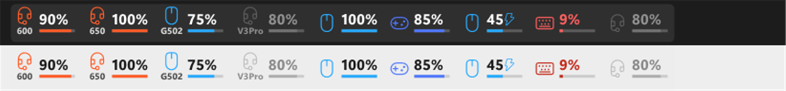

# BatteryTray

Mostra a bateria dos seus dispositivos sem fio (mouse, headset, teclado, controle) **direto na barra de tarefas do Windows 11**, num painel ao lado da bandeja: o ícone colorido de cada aparelho, a porcentagem e uma barra de bateria.



- **Normal:** o ícone na cor do aparelho, a porcentagem e a barra.
- **Carregando:** o `%` vira um raio, por exemplo `45⚡`.
- **Desligado ou fora de alcance:** fica cinza e mostra o último valor conhecido. Passando o mouse, aparece quando ele foi lido, por exemplo "lido ontem às 22:00".
- **Bateria baixa (15% ou menos):** fica vermelho e, se o aviso estiver ligado, chega uma notificação.
- **Detalhes:** passando o mouse, aparece o nome do aparelho e a porcentagem. Clique para reler as baterias; clique com o botão direito para abrir o menu.

Cores, nomes curtos (como o `600` acima), ordem, tamanho, barra e `%` podem ser trocados em **Personalizar...**, no menu. Quem preferir o visual anterior, um ícone por aparelho dentro da bandeja, também escolhe lá.

<p align="center"></p>

## Instalação

1. Baixe o **`BatteryTray.exe`** da [versão mais recente](https://github.com/HenriqueGomez/BatteryTray/releases/latest).
2. Coloque o arquivo numa pasta sua, por exemplo `%LOCALAPPDATA%\BatteryTray`. Evite `C:\Program Files`: o app se atualiza trocando o próprio `.exe` e precisa poder gravar na pasta onde está.
3. Abra o `BatteryTray.exe`. O executável não é assinado digitalmente, então na primeira vez o Windows pode mostrar **"O Windows protegeu o computador"**. Clique em **Mais informações → Executar assim mesmo**. Se preferir, compile você mesmo a partir do código (veja [Compilar](#compilar)).

   > **Bloqueado pelo Controle Inteligente de Aplicativos?** Esse recurso do Windows 11 bloqueia todo programa sem assinatura digital, e o BatteryTray ainda não tem uma. Ele não tem a opção "Executar assim mesmo" nem aceita exceção para um app só, e compilar você mesmo não muda isso. A única forma de usar o app é desligar o recurso em *Segurança do Windows → Controle de aplicativos e do navegador → Configurações do Controle Inteligente de Aplicativos*. Com o Windows atualizado (desde abril de 2026), dá para religar depois pelo mesmo lugar. Em versões anteriores, desligar era definitivo e só voltava reinstalando o Windows.
4. Os aparelhos encontrados aparecem no painel, à esquerda da bandeja. Se os apps abertos ocuparem esse espaço, o painel some até ter lugar de novo; o menu continua no ícone de bateria do BatteryTray, dentro da setinha **`^`**.
5. No menu (clique direito no painel), ligue **Iniciar com o Windows**.

**Requisitos:** Windows 11. Não precisa instalar nada além do app: ele usa o .NET Framework 4.8, que já vem no Windows.

## Menu

O menu abre com o clique direito no painel (ou em qualquer aparelho, no modo de ícones), ou no ícone de bateria do BatteryTray, dentro da setinha `^`:

- **Dispositivos na barra:** escolha quais aparelhos aparecem. Os interruptores não fecham o menu.
- **Personalizar...:** abre uma janela com prévia ao vivo. Nela você escolhe o estilo (painel ou um ícone por aparelho na bandeja), liga ou desliga a barra, o `%` e os nomes curtos, troca o tamanho (o **Compacto** mostra só o ícone e a bateria) e, para cada aparelho, a cor, o nome curto e a ordem.
- **Atualizar agora:** relê as baterias sem fechar o menu. Isso também acontece sozinho a cada minuto, e na hora quando um aparelho é plugado ou desplugado, ou quando um aparelho Logitech, Razer ou de receptor "2.4G 8K" liga, desliga ou muda a bateria.
- **Iniciar com o Windows.**
- **Avisar bateria baixa:** mostra uma notificação do Windows quando um aparelho chega a 15% e outra em 5%. Depois de carregar, volta a avisar. Respeita o "Não incomodar". Vem ligado.
- **Verificar atualizações:** mostra a versão instalada e, quando existir uma nova, vira **Atualizar para vX.Y.Z**. O app também procura sozinho, ao abrir e a cada 6 horas, e avisa com uma notificação do Windows. Clicar na notificação já começa a atualização. A atualização baixa o novo `.exe`, confere o SHA-256 publicado no Release, troca o arquivo e reabre o app.
- **Gerar diagnóstico:** cria o arquivo `BatteryTray-diagnostico-<data>.txt` na pasta do app e abre a pasta com ele selecionado. Leva alguns segundos. Veja [Um aparelho não aparece?](#um-aparelho-não-aparece)

## O que ele detecta

| Origem | Como lê |
|---|---|
| **Logitech** (receptores LIGHTSPEED, Unifying e Bolt, ou aparelho no cabo) | HID++ 2.0 direto no aparelho (features `0x1004`, `0x1000`, `0x1001` e `0x1F20`). Não precisa do G HUB. |
| **Razer, headsets** (ex.: Kraken V3 Pro) | Eventos de bateria que o **Razer Synapse 4** grava nos logs dele. O Synapse precisa estar aberto. |
| **Razer, mouses e teclados sem fio** | Relatório USB de 90 bytes, o mesmo protocolo documentado pelo projeto [openrazer](https://github.com/openrazer/openrazer). |
| **Controles GameSir** (ex.: Cyclone 2, pelo receptor, no modo XInput) | Protocolo do GameSir Connect, documentado pelo projeto [gamesir-reverse-engineering](https://github.com/pedrosegato/gamesir-reverse-engineering). |
| **Mouses com receptor "2.4G 8K HS Receiver"** (Beken/CompX: AULA, Attack Shark, Delux, INPHIC e outros) | O mouse envia a bateria sozinho ao receptor a cada ~2 s. Com o mouse dormindo, mostra o último valor. |
| **Headsets MCHOSE** (ex.: V9 Turbo+, pelo receptor) | Pedido de bateria do receptor. Carregando no cabo, o headset para de responder e aparece apagado. |
| **Bluetooth (qualquer marca)** | A bateria que o próprio Windows conhece, a mesma de *Configurações → Bluetooth e dispositivos*. |
| **USB/HID genérico** | Campo de bateria padrão HID (`Battery Strength` ou `Remaining Capacity`). |
| **Controles XInput** | Quando o controle informa a bateria. |

### Outras marcas (a maioria ainda não testada)

Estes aparelhos usam protocolos documentados por projetos abertos que já leem essas baterias, como [HeadsetControl](https://github.com/Sapd/HeadsetControl), [rivalcfg](https://github.com/flozz/rivalcfg), [G-Helper](https://github.com/seerge/g-helper), [ckb-next](https://github.com/ckb-next/ckb-next), [mxw](https://github.com/korkje/mxw), o [SDL](https://github.com/libsdl-org/SDL) e os drivers do Linux. O BatteryTray usa só os fatos desses protocolos (quais bytes cada aparelho entende), com código próprio. Ele manda apenas pedidos de leitura, e só para os modelos da lista: nunca comandos que gravam configurações ou atualizam o firmware.

Fora o HyperX Cloud III Wireless, nenhum deles foi testado com o BatteryTray, então algum pode não aparecer ou mostrar a bateria errada. Nesse caso, [abra uma *issue*](#um-aparelho-não-aparece) com o diagnóstico: ele mostra a resposta de cada um.

| Tipo | Aparelhos |
|---|---|
| **Headsets** | **HyperX** Cloud III Wireless, Cloud II Wireless, Cloud II Core Wireless, Cloud Alpha Wireless, Cloud Alpha 2 Wireless, Cloud Flight, Cloud Flight S, Cloud Stinger Core Wireless · **SteelSeries** Arctis 1, 7, 7P, 7X, 9, Pro Wireless, 7+, Nova 3P/3X, Nova 5/5X, Nova 7 (todas as versões), Nova Pro Wireless, GameBuds · **Corsair** Void, Void Pro, Void Elite, HS70, HS80, Virtuoso XT/SE, Void Wireless v2, Virtuoso MAX, HS80 MAX · **JBL** Quantum 520, 650, 850 e 950 · **Sony** INZONE H9 II e H5 · **Audeze** Maxwell e Maxwell 2 · **ASTRO** A50 (4ª e 5ª geração) · **Logitech** G535 |
| **Mouses** | **SteelSeries** Aerox 3/5/9 Wireless, Prime Wireless, Prime Mini Wireless, Rival 3 Wireless, Rival 650 · **ASUS ROG/TUF** Keris, Gladius II/III, Chakram, Harpe, Pugio II, Spatha X, Strix Impact II, Strix Carry, TUF M4 · **Glorious** Model O/O-/D/D- Wireless · **Receptores CompX e Areson** (VXE, ATK, Pulsar, Lamzu, Redragon M719/M913/M915, Ajazz, Fantech) · **Corsair** Dark Core, Ironclaw, Harpoon, M65 Ultra, M75 · **HyperX** Pulsefire Dart, Pulsefire Haste 2 · **Keychron** M5 e M6 |
| **Teclados** | **ASUS ROG** Azoth, Strix Scope II 96, Falchion · **Corsair** K57 Wireless, K63 Wireless, K70 Pro Mini Wireless |
| **Controles** | **Sony** DualSense, DualSense Edge e DualShock 4 · **Nintendo** Switch Pro Controller, Joy-Con e controles do Switch Online · **8BitDo** Ultimate 3 (modo D-input) |

**Controles da Sony e da Nintendo:** o app só escuta o que o controle já manda. No cabo, a bateria vem sempre. Pelo Bluetooth, o DualSense, o DualShock 4 e os controles do Switch só mandam a bateria depois que algum programa, como o Steam ou um jogo, liga o modo completo. Pedir isso daqui mudaria o modo do controle até ele reconectar e atrapalharia jogos antigos, então, sem esse programa aberto, o controle não aparece.

**Não funciona com:**
- dongles 2.4 GHz com protocolo próprio da marca que não estão nas listas acima;
- controles cujo receptor se apresenta ao Windows como "com fio" (por exemplo, o dongle da 8BitDo);
- headsets cujo receptor 2.4 GHz não transmite a bateria, como o **Baseus AeQur GH02** (receptor `10D6:4802`, chip da Actions). Pelo Bluetooth, ele aparece se o Windows mostrar a bateria em *Configurações → Bluetooth e dispositivos*;
- aparelhos Logitech que só informam a tensão: nesse caso a porcentagem é uma **estimativa**.

**Testado com:** Logitech G502 X PLUS, Razer Kraken V3 Pro, GameSir Cyclone 2, Delux M900 Pro (receptor 2.4G), MCHOSE V9 Turbo+ e HyperX Cloud III Wireless. Outros aparelhos usam os mesmos protocolos, mas podem se comportar diferente.

### Um aparelho não aparece?

1. Ligue o aparelho e deixe-o conectado.
2. No menu, clique em **Gerar diagnóstico**. A pasta do app abre com o arquivo `BatteryTray-diagnostico-<data>.txt` selecionado.
3. Abra uma [*issue*](https://github.com/HenriqueGomez/BatteryTray/issues/new) com o modelo do aparelho e anexe o arquivo.

O arquivo lista o que o app encontra: aparelhos USB/HID e as funções que cada um declara, aparelhos Bluetooth e se informam bateria ao Windows, controles XInput, programas dos fabricantes abertos e a leitura de cada fonte. Ele **não** tem números de série, endereços Bluetooth nem caminhos completos dos aparelhos, mas mostra os nomes deles. Como alguns nomes Bluetooth incluem o nome do dono, dê uma olhada antes de compartilhar.

Se o app nem abrir, rode `BatteryTray.exe --diagnostico` no terminal, na pasta dele: o arquivo é gerado sem abrir a interface. Quando não é possível gravar na pasta do app, ele vai para a Área de Trabalho.

## Privacidade e o que o app acessa

- **Internet:** só o `api.github.com` e os downloads deste repositório, para verificar e baixar atualizações. Isso acontece ao abrir, a cada 6 horas ou quando você pede pelo menu. Nenhum dado seu é enviado, além do que qualquer acesso à internet já revela (como o seu IP para o GitHub).
- **Aparelhos:** lê a bateria conversando direto com os aparelhos e receptores das marcas da lista acima (somente pedidos de leitura, e só para os modelos conhecidos) e com as propriedades de dispositivos do Windows.
- **Arquivos:** lê os logs do Razer Synapse em `%LOCALAPPDATA%\Razer\RazerAppEngine\User Data\Logs`. Só grava o arquivo de diagnóstico quando você pede, e ele não é enviado a lugar nenhum.
- **Registro do Windows, só no seu usuário:**
  - `HKCU\Software\BatteryTray` guarda os aparelhos ocultos, a identificação de cada ícone, se o aviso de bateria baixa está ligado, a última versão nova avisada e a aparência escolhida em **Personalizar...**;
  - `HKCU\...\CurrentVersion\Run` guarda o início com o Windows, se você ligar.

## Desinstalar

1. No menu, desligue **Iniciar com o Windows** e clique em **Sair**.
2. Apague a pasta onde está o `BatteryTray.exe`.
3. Se quiser remover também as preferências, apague a chave `HKCU\Software\BatteryTray` no Editor do Registro.

## Compilar

Basta rodar `build.cmd`. Ele usa o compilador C# do .NET Framework 4, que já vem no Windows, então não precisa instalar nenhum SDK. Os avisos do compilador são tratados como erro.

Para testar sem abrir a interface, rode `BatteryTray.exe --dump`. Ele grava as leituras e prévias dos ícones na pasta `preview\`.

## Publicar uma versão (mantenedor)

1. Enquanto trabalha, anote o que mudou no [`CHANGELOG.md`](CHANGELOG.md), na seção **`## [Não publicado]`**, em linguagem de quem usa o app.
2. No PowerShell, dentro da pasta do projeto:

   ```powershell
   .\release.ps1 1.2.0
   ```

O script:
1. transforma a seção `[Não publicado]` em `[1.2.0] - data`. Se ela estiver vazia, ele recusa publicar;
2. fecha o BatteryTray, se estiver aberto a partir desta pasta;
3. atualiza `Updater.Version` no código e compila;
4. faz o commit, cria a tag `v1.2.0`, envia e reabre o app.

Depois, o GitHub Actions compila e publica o Release com o `BatteryTray.exe` e o `BatteryTray.exe.sha256`. As notas do Release são a seção da versão no `CHANGELOG.md`.

> Num *fork*, troque `HenriqueGomez/BatteryTray` em `Updater.Repo` (no `BatteryTray.cs`) e no `release.ps1` pelo seu repositório.

## Licença

[MIT](LICENSE)
