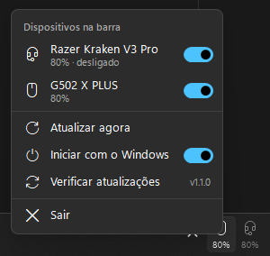
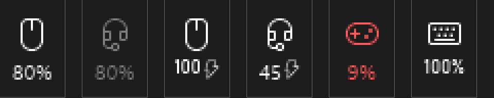

# BatteryTray

Mostra a bateria dos seus dispositivos sem fio (mouse, headset, teclado, controle) **direto na barra de tarefas do Windows 11**. Cada aparelho vira um ícone fixado, com o desenho do aparelho em cima e a porcentagem embaixo.

<p align="center"></p>

Como cada aparelho aparece na barra (prévia ampliada):



- **Normal:** a porcentagem, por exemplo `80%`.
- **Carregando:** o `%` vira um raio, por exemplo `45⚡`.
- **Desligado ou fora de alcance:** o ícone fica apagado e mostra o último valor conhecido.
- **Bateria baixa (15% ou menos):** o texto fica vermelho.
- **Detalhes:** passando o mouse, aparece o nome do aparelho e a porcentagem.

## Instalação

1. Baixe o **`BatteryTray.exe`** da [versão mais recente](https://github.com/HenriqueGomez/BatteryTray/releases/latest).
2. Coloque o arquivo numa pasta sua, por exemplo `%LOCALAPPDATA%\BatteryTray`. Evite `C:\Program Files`: o app se atualiza trocando o próprio `.exe` e precisa poder gravar na pasta onde está.
3. Abra o `BatteryTray.exe`. O executável não é assinado digitalmente, então na primeira vez o Windows pode mostrar **"O Windows protegeu o computador"**. Clique em **Mais informações → Executar assim mesmo**. Se preferir, compile você mesmo a partir do código (veja [Compilar](#compilar)).
4. Os aparelhos encontrados aparecem dentro da setinha **`^`** da bandeja. **Arraste cada um para a barra de tarefas** e o Windows passa a lembrar dessa posição.
5. No menu (clique direito no ícone), ligue **Iniciar com o Windows**.

**Requisitos:** Windows 11. Não precisa instalar nada além do app: ele usa o .NET Framework 4.8, que já vem no Windows.

## Menu

O menu abre com o clique direito em qualquer aparelho, ou no ícone de bateria quando nenhum aparelho estiver visível:

- **Dispositivos na barra:** escolha quais aparelhos aparecem. Os interruptores não fecham o menu.
- **Atualizar agora:** relê as baterias. Isso também acontece sozinho a cada minuto.
- **Iniciar com o Windows.**
- **Verificar atualizações:** mostra a versão instalada e, quando existir uma nova, vira **Atualizar para vX.Y.Z**. A atualização baixa o novo `.exe`, confere o SHA-256 publicado no Release, troca o arquivo e reabre o app.

## O que ele detecta

| Origem | Como lê |
|---|---|
| **Logitech** (receptores LIGHTSPEED, Unifying e Bolt, ou aparelho no cabo) | HID++ 2.0 direto no aparelho (features `0x1004`, `0x1000`, `0x1001` e `0x1F20`). Não precisa do G HUB. |
| **Razer, headsets** (ex.: Kraken V3 Pro) | Eventos de bateria que o **Razer Synapse 4** grava nos logs dele. O Synapse precisa estar aberto. |
| **Razer, mouses e teclados sem fio** | Relatório USB de 90 bytes, o mesmo protocolo documentado pelo projeto [openrazer](https://github.com/openrazer/openrazer). |
| **Bluetooth (qualquer marca)** | A bateria que o próprio Windows conhece, a mesma de *Configurações → Bluetooth e dispositivos*. |
| **USB/HID genérico** | Campo de bateria padrão HID (`Battery Strength` ou `Remaining Capacity`). |
| **Controles XInput** | Quando o controle informa a bateria. |

**Não funciona com:**
- dongles 2.4 GHz que usam protocolo próprio da marca;
- controles cujo receptor se apresenta ao Windows como "com fio" (por exemplo, o dongle da 8BitDo);
- aparelhos Logitech que só informam a tensão: nesse caso a porcentagem é uma **estimativa**.

Só foi testado com um Logitech G502 X PLUS e um Razer Kraken V3 Pro. Outros aparelhos usam os mesmos protocolos, mas podem se comportar diferente. Se encontrar algum problema, abra uma *issue* com o modelo.

## Privacidade e o que o app acessa

- **Internet:** só o `api.github.com` e os downloads deste repositório, para verificar e baixar atualizações. Isso acontece ao abrir, a cada 6 horas ou quando você pede pelo menu. Nenhum dado seu é enviado, além do que qualquer acesso à internet já revela (como o seu IP para o GitHub).
- **Aparelhos:** lê a bateria conversando direto com receptores Logitech e Razer (somente comandos de leitura) e com as propriedades de dispositivos do Windows.
- **Arquivos:** lê os logs do Razer Synapse em `%LOCALAPPDATA%\Razer\RazerAppEngine\User Data\Logs`.
- **Registro do Windows, só no seu usuário:**
  - `HKCU\Software\BatteryTray` guarda os aparelhos ocultos e a identificação de cada ícone;
  - `HKCU\...\CurrentVersion\Run` guarda o início com o Windows, se você ligar.

## Desinstalar

1. No menu, desligue **Iniciar com o Windows** e clique em **Sair**.
2. Apague a pasta onde está o `BatteryTray.exe`.
3. Se quiser remover também as preferências, apague a chave `HKCU\Software\BatteryTray` no Editor do Registro.

## Compilar

Basta rodar `build.cmd`. Ele usa o compilador C# do .NET Framework 4, que já vem no Windows, então não precisa instalar nenhum SDK. Os avisos do compilador são tratados como erro.

Para testar sem abrir a interface, rode `BatteryTray.exe --dump`. Ele grava as leituras e prévias dos ícones na pasta `preview\`.

## Publicar uma versão (mantenedor)

No PowerShell, dentro da pasta do projeto:

```powershell
.\release.ps1 1.2.0
```

O script:
1. fecha o BatteryTray, se estiver aberto a partir desta pasta;
2. atualiza `Updater.Version` no código e compila;
3. faz o commit, cria a tag `v1.2.0`, envia e reabre o app.

Depois, o GitHub Actions compila e publica o Release com o `BatteryTray.exe` e o `BatteryTray.exe.sha256`.

> Num *fork*, troque `HenriqueGomez/BatteryTray` em `Updater.Repo` (no `BatteryTray.cs`) e no `release.ps1` pelo seu repositório.

## Licença

[MIT](LICENSE)
